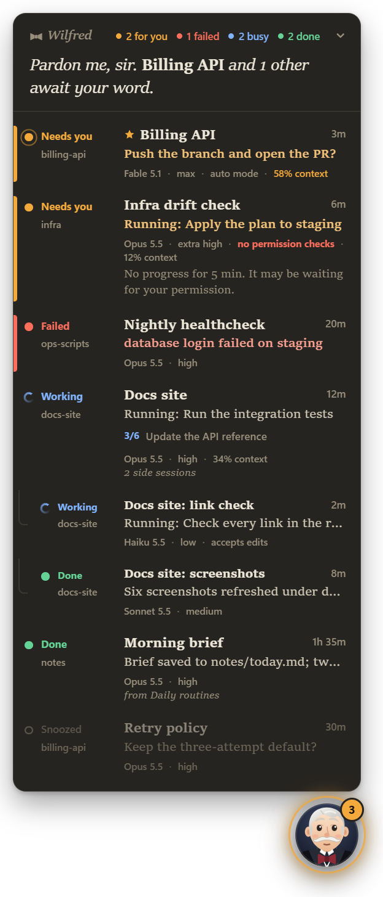
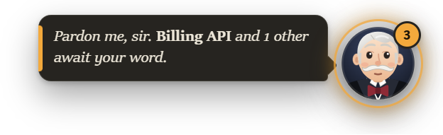
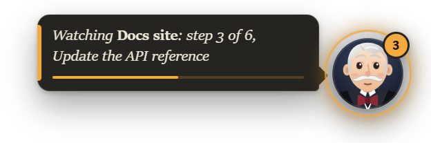
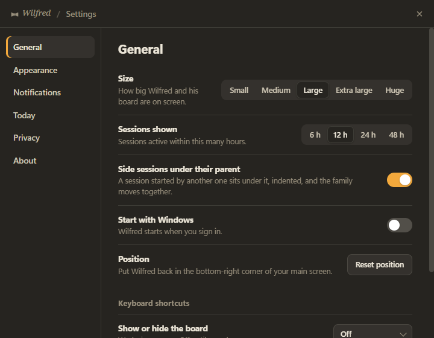
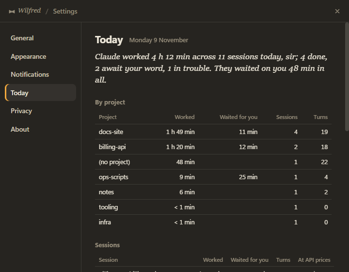
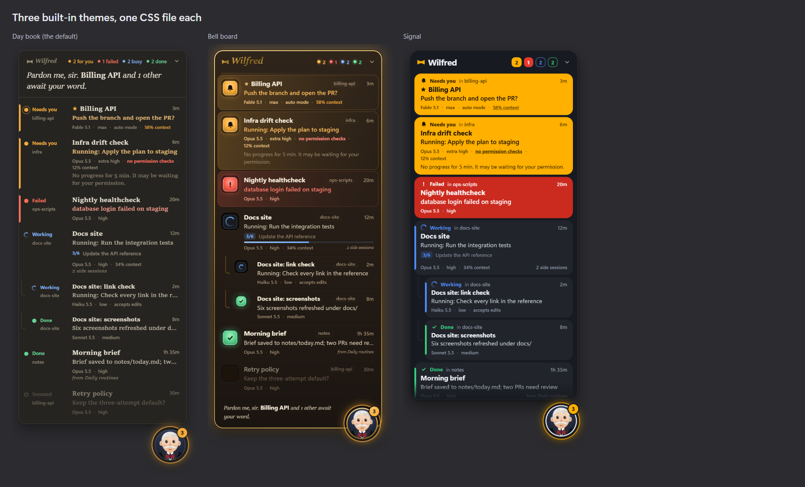

<h1> Wilfred</h1>

[](https://github.com/ArduusLabs/wilfred/actions/workflows/test.yml)

**A small always-on-top butler that tells you, at a glance, what every Claude Code session in the
Claude desktop app is doing, and which one needs you.**

When you run several Claude sessions side by side, it's easy to miss the one that has been waiting on
a question for twenty minutes. Wilfred keeps one live row per session in a corner of your screen.
Sessions that need you go to the top, with the actual question in the row.

<p align="center">
  
  &nbsp;&nbsp;
  
</p>

<sub>Screenshots use made-up sessions (`npm run demo`).</sub>

> [!NOTE]
> Wilfred is an unofficial side project and is not affiliated with or endorsed by Anthropic. He reads
> files the Claude desktop app keeps on your computer. Their format isn't documented, so an app update
> can break him until he's adapted.

## Your work stays on your machine

Most of us use Claude Code for work. Wilfred reads your sessions' titles, prompts and transcripts,
which means your work material. I wouldn't install an app that could do that and also talk to the
internet, so Wilfred is built so that it **can't**, and so that nobody can quietly change that:

- **No network access, enforced.** Before Wilfred loads anything else, it switches off every way
  its process could connect out: sockets, DNS, HTTP, `fetch`, WebSockets, and Chromium's own
  networking. Even if someone slipped a line of code in that tried to send something, it would fail.
  When Wilfred starts, it tries every way out and logs `network: locked`; his menu shows the result
  with a green mark, **Privacy check passed: Wilfred can't reach any network**, and what was checked
  one level down. (If that check ever failed, the line would turn red and say what's open.)
- **Read-only.** Wilfred only reads the Claude app's session files and Claude Code's transcripts.
  It writes nothing outside its own settings folder: its settings (window position, size, theme)
  and, in `themes/` there, copies of the built-in themes for you to edit.
- **Nothing changed in Claude.** No hooks, no edits to `~/.claude/settings.json`.
- **No dependencies at run time.** The only package is Electron, pinned to an exact version.
- **Nothing sensitive on screen by accident.** The board is hidden from screen sharing by default,
  and shell commands are shown by their description, never the command itself.

**Every change is checked.** A pull request can't be merged if it adds network code, a URL to an
outside host, a new dependency or install script, or weakens the sandbox. A check in CI
(`tools/check-isolation.js`) fails it, and the files that keep Wilfred offline need a maintainer's
review. Details are in [SECURITY.md](SECURITY.md).

**Check it yourself:**

```bash
npm run verify-offline
```

This starts Electron with exactly Wilfred's lock and tries every way out (TCP, DNS, HTTP, `fetch`,
Electron's network module, a page's requests and WebSockets), against real public addresses.
Every attempt must be refused. Add `-- --control` to run the same attempts without the lock and
see that they'd otherwise get through.

## What it shows

One row per session, the ones that need you first:

| Row | Meaning |
| --- | --- |
| **Needs you** (amber) | an unanswered question or plan approval, the question in the session's next-step box, or a tool that has probably been waiting on a permission prompt (the row says for how long) |
| **Failed** (red) | the session's last turn ended in failure |
| **Working** (blue) | what it's doing right now ("Running: integration tests", "Editing main.js") and its task-list step, e.g. `3/6`, with a progress bar. "Starting…", "Wrapping up…" and "Reading what came back…" are the moments in between, drawn softer |
| **In background** | the turn ended, but an agent or background command is still running |
| **Done** (green) | finished since you last opened that session |
| **Idle** | nothing going on; past a few of these, the rest fold into "+N quiet sessions" |

Each theme draws these in its own way (a lit lamp, a colour block, a word in the margin), always
in those colours. Hover a row for the full update, the branch it is on and what it has used so far.
Click it to open that session in the Claude app; right-click it for its menu (below).

Every row also says **what the session runs on**: the model and effort ("Opus 5.5 · high") and,
when it isn't the default, the permission mode ("auto mode", "accepts edits"). A session running
with **no permission checks** says so in red, so you can see at a glance which one is unguarded.
Next to them, **how full its context is** ("34% context"): the same figure the Claude app shows,
read from the session's last reply (input tokens plus cache, over the model's window: 200k, or 1M
for the models that have it). The figure changes colour as the window fills, like the app's own
meter: amber from half, red past 80%, when a compaction is near and that is the session to compact
or start fresh. On hover, the row's facts give the numbers ("337k of 1.0M tokens in context").
Sessions you **starred** in the Claude app sort first within their state, with a star.

**Side sessions** (ones another session started) sit under their parent, indented, and the family
moves together: when a side session needs you, the whole family comes up to where it belongs. A
scheduled routine's runs are sessions of their own with the same title, so they fold into one row:
the run most recently active, with any other run still waiting on you noted in its detail.

## Download

You need the Claude desktop app (with Claude Code sessions). Each release on the
[releases page](https://github.com/ArduusLabs/wilfred/releases) has Wilfred built for Windows, macOS and
Linux, each for x64 and arm64, plus `SHA256SUMS.txt` to check them
(`sha256sum -c SHA256SUMS.txt --ignore-missing`). They are built by GitHub Actions from the commit the
release names ([`.github/workflows/release.yml`](.github/workflows/release.yml)); nothing is installed,
and nothing in them updates itself. They are not signed, so each system warns you once:

- **Windows** (`windows-x64`; `windows-arm64` for Snapdragon PCs): unzip it anywhere you like, and run
  `Wilfred.exe` in the folder. SmartScreen says "Windows protected your PC": choose **More info**, then
  **Run anyway**. To move him, move the whole folder, then switch **Start with Windows** off and on.
- **macOS** (`macos-arm64` for Apple silicon, `macos-x64` for Intel): unzip, move `Wilfred.app` to
  Applications and open it. macOS refuses the first time; go to **System Settings > Privacy & Security**
  and choose **Open Anyway**. Or, in Terminal: `xattr -dr com.apple.quarantine /Applications/Wilfred.app`.
- **Linux** (`linux-x64`, `linux-arm64`): extract the `.tar.gz` and run `resources/app/start-wilfred.sh`
  inside the folder. On Ubuntu 24.04 and later, run `resources/app/tools/linux-apparmor.sh` once first
  (see [Linux](#linux)).

Your settings live in the same place whichever way you run him, so switching from a checkout to a
download keeps them.

## Run from a checkout

You need the Claude desktop app (with Claude Code sessions) and [Node.js](https://nodejs.org) 22.12 or newer.

```bash
git clone https://github.com/ArduusLabs/wilfred.git
cd wilfred
npm install
npm start
```

Electron's build for your platform is fetched the first time Wilfred starts (by `npm start` or one
of the launchers below), so install on each machine rather than copying `node_modules` between
them.

To start him without a terminal window, use `start-wilfred.cmd` (Windows), `start-wilfred.command`
(macOS) or `start-wilfred.sh` (Linux). Running any of them again while he's hidden brings him back.
To have him start when you sign in, open Settings and switch on **Start with Windows** (**Open at
login** on a Mac, **Start at login** on Linux). Mac and Linux users: read [Platform support](#platform-support)
first; Linux hasn't been run by the author yet.

## Using Wilfred

- **Click Wilfred** to fold the board away. He then sums things up in a speech bubble; click the
  bubble to open the session he mentions. His mood follows the board: he dozes when all is quiet,
  nods along while sessions work, smiles with a green glow at news, and hops with an amber glow when
  something needs you.
- **Drag** Wilfred or the board's header to move it. It stays where you leave it, always inside the screen.
- **Tray / menu bar icon:** hover for a summary ("Wilfred: 2 for you, 1 busy"), click to show or hide
  him, right-click for the menu.
- **Right-click** Wilfred or the tray icon for a short menu: show or hide the sessions, open Claude,
  **Copy status as text** (the board as plain text, for a stand-up or a message), **Settings…**,
  **Day book…**, **Do not disturb** (30 minutes, an hour, two hours, or until you turn it off: nothing
  hops, rings or notifies until it's over), the privacy check's result (green when it passed; see
  below), and **Quit**.
- **Right-click a row** for that session's menu: open it, open its project folder, **watch** it,
  **snooze** it (15 minutes, an hour, or until it changes), copy its link, title or branch.
  - A snoozed session stays listed, dimmed and asking for nothing; it comes back on its own when the
    time is up, or the moment it changes.
  - A watched session is the one Wilfred's bubble follows while it works, with its progress bar, and
    he tells you the moment it needs you, fails or finishes, whatever your notification settings say.
    One session at a time; stop watching from the same menu.

    
- **Keyboard shortcuts** (off until you pick them in Settings): show or hide the board, and open the
  session that needs you most (the first waiting for you; failing that, one that failed; failing
  that, the last one finished; failing that, Claude itself). They work from any app.
- **Notifications:** your system's own, on this computer, and off until you switch them on in
  Settings (the Claude app already shows its own for questions, permissions and finished sessions).
  Wilfred's add a session that failed, one working for a while, and the session you watch. A question
  or a result waits half a minute before it's told, so the session you're sitting in doesn't notify
  you; nothing is said under do not disturb. Click one to open the session. They can carry the
  session's question; switch that off for shared screens. On Windows, Wilfred adds a Start Menu entry
  with his name and icon while they're on, so they say "Wilfred" rather than "Electron" (the name
  Electron itself gives an app run from its folder, through a Start Menu entry of its own that
  Wilfred folds into his); Windows may take a few minutes to start using the name, and relabels the
  earlier ones in its notification centre once it has. The entry goes when you switch them off. (The downloaded
  `Wilfred.exe` needs none of this: the entry Electron writes for it already says Wilfred, and it
  stays.)

### Settings

<p align="center">
  
</p>

**Settings…** in the menu opens a small window, dressed in whichever theme you run:

- **General**: size (Small to Huge, for high-resolution screens), how many hours of sessions to
  show, whether side sessions nest under their parent, start at login, a button to put Wilfred back
  in the corner of your main screen, and the two keyboard shortcuts. On a Mac, **Show Wilfred in the
  Dock**; on Linux, **Add to app menu** (see [Platform support](#platform-support)).
- **Appearance**: light, dark or follow the system; the theme, with your own themes next to the
  built-in ones, and the two buttons for the themes folder (see below).
- **Notifications**: on or off, which events to be told about, whether the question is shown, the
  sound, a button that sends one so you can see what they look like, and **Do not disturb**.
- **Today**: the day book (below), with **Copy as text**.
- **Privacy**: the startup check's result with what was checked, what Wilfred reads and writes,
  **Hide from screen sharing** (on by default, because the board shows prompt text), and a button
  that opens SECURITY.md.
- **About**: the version, the licence, and a button that opens the project page in your browser.
  That page is the one address outside `claude://` links that Wilfred will ever open, on your click;
  Wilfred itself still never connects to anything.

Every change applies at once; there is nothing to save.

### The day book

<p align="center">
   Today: the day book, with time worked per project and per session">
</p>

While he runs, Wilfred keeps a journal of the day: how long Claude worked, per session and per
project; how long sessions waited for you; turns completed; lines added and removed; and what each
session would have cost at API prices (from Claude Code's own running figures). **Settings > Today**
shows it, in his words ("Claude worked 4 h 12 min across 6 sessions today, sir; 3 done, 1 awaits
your word. They waited on you 48 min in all."), with a table per project and per session;
**Copy as text** puts the same on your clipboard for a stand-up or a time sheet. One small file per
day in his settings folder, kept for 30 days; only time while Wilfred runs is counted, never time asleep.

The same running figures show on each row on hover: "≈ $4.11 at API prices · 9.7M tokens · +78 −12
lines". For a subscription they are what the work *would* have cost on the API: a plain measure of
how heavy a session has become.

### Themes

<p align="center">
  
</p>

Pick one under **Settings > Appearance**: **Day book** (paper and type, the state as a word in the
margin; the default), **Bell board** (walnut, brass and lit lamps) or **Signal** (flat colour blocks
you can read from across the room). Each has a light and a dark side; the same page picks which,
or follows the system. Your choice is remembered.

A theme is a single CSS file. **Open themes folder** (on the same page) opens the `themes` folder inside
Wilfred's settings folder (`%APPDATA%\Wilfred\themes` on Windows,
`~/Library/Application Support/Wilfred/themes` on a Mac), where Wilfred keeps a copy of each built-in
theme for you, with a `README.txt` saying the same as this and a copy of
[docs/themes.md](docs/themes.md) (what a theme can style):

- **Edit a copy** (say `Day book.css`) and save: Wilfred uses your version at once while that theme
  is selected, Settings > Appearance marks it **edited**, and your version survives updates. Delete
  the file to get the original back. (A copy you haven't edited is kept in step with Wilfred's own.)
- **Copy one under a new name** for a theme of your own: it appears in Settings > Appearance under
  that file name (letters, digits, spaces, dots, dashes and underscores; under
  1 MB). **Save current theme as a custom theme** does the copy for you and switches to it.

Edits apply as you save; there's no need to restart. [docs/themes.md](docs/themes.md) lists what a
theme can style. A theme can't load anything from the internet, since Wilfred can't.

To try a theme for one run without changing your setting, start Wilfred with `--theme=<id>`, for
example `--theme=signal` or `--theme="custom/My theme"`.

### Flags and environment variables

| Environment variable | Default | What it does |
| --- | --- | --- |
| `WILFRED_WINDOW_HOURS` | `12` | Show sessions active within this many hours. Read until Wilfred first saves his settings (any change in Settings does, and so does folding the board); from then on Settings > General decides |
| `WILFRED_SESSIONS_DIR` | found automatically | The Claude app's `claude-code-sessions` folder, if Wilfred can't find it |

`--user-data-dir=<folder>` and `--demo` keep their own settings, separate from your real ones.
`--theme=<id>` shows that theme for one run without saving it; `--settings` (or `--settings=today`)
opens the settings window at startup. `--wilfred-toggle`, `--wilfred-settings` and `--wilfred-quit`
tell a running Wilfred to show or hide the board, open Settings, or quit (the Linux app-menu entry
uses them; they work everywhere).

### Your own picture

Put `avatar.jpg` (or `.png` or `.webp`, up to 5 MB) in Wilfred's settings folder and restart him. It
replaces the drawn butler. The settings folder is `%APPDATA%\Wilfred` on Windows,
`~/Library/Application Support/Wilfred` on a Mac and `~/.config/Wilfred` on Linux.

## How it works

Wilfred only **reads** two things the Claude app and Claude Code already keep on your computer:

1. **The desktop app's per-session files** (`…/claude-code-sessions/<account>/<org>/local_*.json`). These give:
   - the session's title, its star, and the session that started it;
   - the model, effort, permission mode and branch;
   - when you last opened it;
   - when its last turn ended, and how many turns it has done;
   - the status line the sidebar shows.
2. **The end of each session's Claude Code transcript** (`~/.claude/projects/…/<id>.jsonl`). This shows:
   - the tool running right now;
   - a pending question;
   - the task-list step;
   - background work and when it finishes;
   - the running cost, tokens and lines changed (Claude Code's own `cost-state` records).

Only sessions active in the window are read, and only the last 512 KB of a transcript (up to 4 MB
when a turn started further back). Clicking a row opens `claude://code/continue?session=<id>`, the
app's own link for a session.

### Privacy

Everything stays on your machine; see [Your work stays on your machine](#your-work-stays-on-your-machine)
and [SECURITY.md](SECURITY.md). The page itself also runs sandboxed under a strict content
security policy, and everything it shows is plain text.

## Platform support

| Platform | Status |
| --- | --- |
| Windows 11 | Used daily |
| macOS | Run on macOS 27 (Apple silicon), from a checkout and as the downloaded `Wilfred.app`. One known issue: [notifications](#macos). Open at login not tried yet |
| Linux | Built from Electron's documentation and other overlay apps' experience, not yet run: Ubuntu (GNOME, Wayland and X11) and KDE Plasma are the targets; see below |

[docs/platforms.md](docs/platforms.md) lists what those other overlays ran into, on every
platform, and what Wilfred does about each.

### macOS

- **Known issue: no notifications.** macOS doesn't let an app without an Apple developer signature
  send notifications, and Wilfred isn't signed (neither the downloaded app nor a checkout). It
  refuses them without asking, and Wilfred never appears under System Settings > Notifications, so
  there is no switch to turn on. Settings > Notifications in Wilfred says when it happened. Everything
  else works: the count beside the menu bar icon and the board are how he tells you.
- **Menu bar first.** Wilfred's icon is a small bow tie in the menu bar (it follows light and dark
  menu bars): click to show or hide him, Ctrl-click or right-click for the menu, and a count appears
  beside it when sessions need you. He has no Dock icon by default: that is what lets the board
  float over other apps' full-screen Spaces.
- **Dock, if you prefer it.** Settings > General > **Show Wilfred in the Dock** gives him a Dock icon
  with his menu, a badge with the count needing you, and a bounce when that count rises. With the
  Dock icon shown, macOS no longer lets the board float over full-screen apps; it still floats over
  everything else.
- **Start him** with `start-wilfred.command` (double-click, or run it in Terminal). The first run
  fetches Electron's macOS build into `node_modules` if `npm install` didn't; after that it opens
  Wilfred through Launch Services, so the Terminal window can close. Running it again while he's
  hidden brings him back.
- **Open at login** (Settings > General) writes a LaunchAgent at
  `~/Library/LaunchAgents/com.arduuslabs.wilfred.login.plist` that starts Electron on Wilfred's folder
  when you log in, with its log in `~/Library/Logs/Wilfred/launchd.log`. If you move the folder,
  start Wilfred once from the new place and the entry follows. Switching it off deletes the file.
- **Clone, don't download.** `git clone` into a folder such as `~/wilfred` or `~/Developer/wilfred`,
  not Documents, Desktop, Downloads or iCloud Drive: at login, macOS asks before an app reads from
  those folders. A ZIP downloaded in a browser is quarantined, and Gatekeeper then blocks the
  `.command` file; `xattr -dr com.apple.quarantine <folder>` clears it.
- **What macOS calls him.** The downloaded `Wilfred.app` is called Wilfred everywhere, and its Open at
  login entry runs the app itself. Run from a checkout, he isn't a packaged, signed app: he runs
  inside Electron's own bundle. So Activity Monitor, the permission prompts, the Login Items list and notifications say
  "Electron". The icon and the About panel are his own.
- **Keyboard.** Cmd+C/V/A/Z work in Settings, Cmd+Q quits, Cmd+W closes Settings.
- `Hide from screen sharing` uses macOS's own window sharing flag; recorders built on
  ScreenCaptureKit may still capture the board.

### Linux

- **Start him** with `start-wilfred.sh` (or add him to your app menu, below). On a Wayland desktop
  (Ubuntu's default) it runs him through XWayland (`--ozone-platform=x11`), because Wayland doesn't
  let an app place its own window, keep it on top or follow the pointer, which is everything Wilfred
  does. `npm start` relaunches itself the same way. `WILFRED_WAYLAND=1` opts out: Wilfred is then an
  ordinary window that your desktop places, that doesn't stay on top by itself (GNOME: Alt+Space >
  Always on Top), and whose position isn't remembered.
- **Ubuntu 24.04 and later** restrict the sandbox Chromium needs, so Electron refuses to start. Wilfred
  won't run without his sandbox and never passes `--no-sandbox`; instead `start-wilfred.sh` explains
  and points at `tools/linux-apparmor.sh`, which shows you the one-paragraph AppArmor profile it
  installs (with your password, once) and installs it. Then start him again.
- **Tray.** KDE Plasma, Cinnamon, XFCE, MATE and Ubuntu's GNOME show his tray icon (left-click, or
  the icon's menu, shows or hides him; the menu has the rest). Plain GNOME (Fedora, Debian) shows no
  tray icons without the "AppIndicator and KStatusNotifierItem Support" extension. Everything in the
  tray menu is also on Wilfred's own right-click menu and in Settings.
- **App menu.** Settings > General > **Add to app menu** writes `~/.local/share/applications/wilfred.desktop`
  (and his icon under `~/.local/share/icons`), with **Show or hide Wilfred**, **Settings** and
  **Quit Wilfred** on the entry's right-click menu. **Remove** deletes both again.
- **Start at login** writes `~/.config/autostart/wilfred.desktop` (GNOME Tweaks and KDE's autostart
  settings show it; switching it off there is respected).
- **Looks.** Wilfred needs a compositor for his see-through window: GNOME and KDE always have one; on
  XFCE keep "Enable display compositing" on; on i3 or Openbox run picom. Without one his background
  is black (start the compositor, then restart him). At 125 % or 150 % scaling, GNOME scales XWayland
  windows and Wilfred may look soft; 100 % and 200 % are sharp, and on recent GNOME
  `gsettings set org.gnome.mutter experimental-features "['scale-monitor-framebuffer','xwayland-native-scaling']"`
  makes him sharp at any scale (log out and in).
- **Hiding from screen sharing** isn't available on Linux. Notifications use your desktop's own
  (libnotify).
- **The Claude app's files.** The Claude desktop app for Linux keeps its data in `~/.config/Claude`,
  which is where Wilfred looks (and `$XDG_CONFIG_HOME/Claude`). If the board stays empty, point
  `WILFRED_SESSIONS_DIR` at its `claude-code-sessions` folder.

## Limits

- **Permission prompts are read from a side effect.** The app keeps pending prompts in memory only,
  but it re-stamps the session's turn time the moment it raises one, which Wilfred spots within a
  tick. As a fallback (say, a prompt raised before Wilfred started) he infers one from a tool that
  has been quiet for longer than that tool should take.
- **Stopped turns:** a turn with nothing pending and no activity for 45 minutes is shown as stopped
  (the app was probably closed). Anything that could be waiting on you stays "needs you" however long it waits.
- **Old background work isn't seen:** work started before the part of the transcript Wilfred reads won't be counted.
- **Local sessions only:** sessions running over SSH or in the cloud aren't shown.

## Development

```bash
npm test                 # unit tests, including the isolation check
npm run coverage         # same, failing below 100% line, branch and function coverage
npm run check-isolation  # just the isolation check (what CI runs first)
npm run verify-offline   # prove the network lock holds, with real connection attempts
npm run ui-check         # start the real app on the demo, look at it in every theme, save pictures
npm run demo             # made-up sessions in every state (WILFRED_DEMO=empty or =many for those boards)
```

| Path | What's there |
| --- | --- |
| `src/sessions/transcript.js` | Reads a transcript's tail and works out what the session is doing |
| `src/sessions/status.js` | Turns that, plus the app's session file, into one row |
| `src/sessions/source.js` | Finds the session folders and polls them |
| `src/window-logic.js`, `src/login-mac.js`, `src/login-linux.js` | Window placement, settings, start at login |
| `src/platform.js` | What differs on Windows, macOS and Linux (window options, tray, Dock, the Linux launcher entry, click-through shape, crash recovery), as pure functions |
| `src/quiet.js`, `src/notify.js`, `src/shortcuts.js`, `src/journal.js` | Snooze and do not disturb, which notifications to raise, the shortcut choices, the day book |
| `src/themes.js` | Finds, reads and watches themes |
| `start-wilfred.cmd`, `start-wilfred.command`, `start-wilfred.sh`, `tools/linux-apparmor.sh` | Launchers per platform, and the Ubuntu sandbox helper |
| `src/renderer/` | The board (`view.js` decides what to show; `renderer.js` draws it; `style.css` is the structure) |
| `src/renderer/themes/` | The built-in themes, one CSS file each ([docs/themes.md](docs/themes.md) is the contract) |
| `src/main.js`, `src/preload.js` | Electron wiring |
| `src/no-network.js` | The network lock, loaded first |
| `tools/check-isolation.js`, `security/` | The isolation check and its reviewed package list |
| `tools/package-app.js`, `.github/workflows/release.yml` | Building the downloads, and publishing them |
| `tools/ui-check.js`, `tools/ui-rules.js` | Looking at the running app (the board, hover, folding, Settings, every theme) and the rules it is held to |
| `tools/check-pr.js`, `.github/pull_request_template.md` | The pull request checklist, and the check that reads a description against it |

The decisions live in plain modules with no Electron dependency, which is what the tests cover.
`main.js`, `preload.js` and `renderer.js` only wire them to the window.

The icons in `assets/` are rendered from the drawn butler with `npx electron tools/make-icons.js`.

### Releases

Every push to `main` (or a manual run of the Release workflow on `main`) publishes a release
`v<version>` for the `version` in `package.json`, unless a tag `v<version>` already exists; then it
builds nothing. So the first push publishes `v0.9.0`, and each later release is a merge that bumps the
version (`npm version minor --no-git-tag-version`). The workflow adds no packages: each build job fetches Electron's own build for its target with
`node_modules/electron/install.js` (checked against the checksums Electron ships), and
`tools/package-app.js` copies it and the app into a folder, renames the executable and leaves Electron's
licences in place. Windows builds then get Wilfred's name, icon and version from Electron's `rcedit`
(fetched by the job and checked against a SHA-256 written in the workflow), Mac builds an edited
`Info.plist` and an ad-hoc signature. Only the last job may write, and only the tag and the release.
To try a build on your own machine (Windows here, against the Electron `npm install` fetched):

```bash
node tools/package-app.js win32 x64 dist/Wilfred-windows-x64
```

## Contributing

Pull requests are welcome. [CONTRIBUTING.md](CONTRIBUTING.md) has the setup, the checks and the
rules every pull request follows: CI fully green, screenshots for anything a person can see, one
small change at a time, no network code and no new packages. CI runs the unit tests on Windows,
macOS and Linux, the isolation check, and the UI check, whose pictures are kept with each run.

## License

[MIT](LICENSE)
